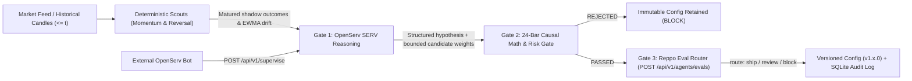

# Aptura — Adaptive AI Trading Supervisor

**Track:** OpenServ Hackathon 02 · Reppo Track  
**Category:** Auditable Agent Supervision & Strategy Risk Governance (Paper Research Laboratory — **zero live money / no wallet custody**)

> **Trading agents adapt blindly. Aptura audits every shift through three independent gates before touching strategy config.**

---

## Why Aptura?

Autonomous trading agents often overfit recent noise, drift silently during regime reversals, or rewrite their own risk weights without an independent audit trail. Aptura treats adaptation as a **verifiable state machine**:

1. **Gate 1 · OpenServ SERV Reasoning (`SERVAnalyst`)** — Diagnoses strategy drift from bounded, past-only telemetry (`observedAtUtc`, trailing EWMA scout scores, recent matured shadow outcomes) using structured JSON Schema output (`json_schema` strict mode with `json_object` fallback). Never touches future bars or computes numerical PnL.
2. **Gate 2 · Zero-Look-Ahead Deterministic Math Gate (`AdaptationEngine` + `validate_weights`)** — Hard Python constraints always outrank LLM output:
   - Bounds check (`[15%, 85%]` per strategy, normalized to `1.0`)
   - Cooldown enforcement (`>= 12` bars between adjustments)
   - Strict causal replay over a separate 24-bar past-only segment (`pastSegmentDeltaPct`) using next-candle-open fills (`20 bps` fee + `15 bps` slippage per side by default)
   - Explicit rejections (e.g., on adversarial whipsaw scenarios such as `synthetic-noise-guard`)
3. **Gate 3 · Independent Reppo Eval Panel (`ReppoClient`)** — Submits sanitized reasoning traces asynchronously to Reppo Eval Router (`POST /api/v1/agents/evals`, `taskType: "action"`), polls `GET /api/v1/agents/evals/{id}`, surfaces rubric scores + route (`ship` / `review` / `block`), and keeps evaluation scores strictly distinct from investment performance.

In addition to its interactive **Terminal**, **Live Market Feed** (Coinbase public market data every 15 seconds), and **Historical Replay** workspace, Aptura exposes **Supervisor-as-a-Service** (`POST /api/v1/supervise` & `GET /api/agent/manifest`) so other OpenServ agents can submit proposed strategy updates and receive deterministic `SHIP | REVIEW | BLOCK` verdicts.

---

## Architecture



---

## Repository Structure

```text
Aptura/
├── apps/web/                     # Next.js 15 App Router UI + Zod contracts
│   ├── app/page.tsx              # Storytelling landing + 3-Gate overview
│   ├── app/onboarding/page.tsx   # Guided 3-step scenario setup
│   ├── app/terminal/page.tsx     # Live market feed, replay & 3-Gate dashboard
│   └── components/
│       ├── ThreeGatePipeline.tsx # Live SERV -> Math Gate -> Reppo Eval UI
│       ├── AgentSupervisePanel.tsx # Supervisor-as-a-Service interactive workbench
│       ├── LiveWorkspace.tsx     # Live Coinbase observation + paper supervisor
│       ├── EquityComparisonChart.tsx
│       ├── MarketReplayChart.tsx
│       ├── InterventionReport.tsx
│       └── ResearchControls.tsx
├── services/api/app/             # FastAPI backend & deterministic replay engine
│   ├── main.py                   # Replay, live, Reppo poll, /api/agent/manifest, /api/v1/supervise
│   ├── domain/models.py          # Typed Pydantic contracts
│   ├── data/                     # Historical dataset catalog & live market adapter
│   ├── strategies/               # Deterministic Momentum & Reversal scouts
│   ├── supervisor/               # Causal adaptation engine, simulator, counterfactuals
│   ├── evaluation/               # OpenServ SERVAnalyst & ReppoClient + job state machine
│   └── storage/                  # SQLite persistence layer
├── data/datasets.json            # Historical replay & adversarial guardrail datasets
├── tests/                        # Unit, integration, hermetic, and live API tests
├── Dockerfile                    # API container
├── apps/web/Dockerfile           # Web UI container
├── docker-compose.yml            # Full-stack Docker Compose setup
├── Start-Aptura.ps1              # Windows convenience launcher
├── .env.example                  # Blank environment template
└── SUBMISSION.md                 # Hackathon write-up, X post draft & demo script
```

---

## Quickstart

### Option 1 · Docker Compose (Linux / macOS / Windows)

```bash
cp .env.example .env
# Optionally populate SERV_API_KEY, SERV_MODEL, REPPO_API_KEY in .env
docker compose up --build
```

- Web UI: `http://localhost:3000`
- Guided 3-Gate Demo: `http://localhost:3000/terminal?scenario=momentum-breakdown&autorun=1`
- FastAPI Docs: `http://localhost:8000/docs`

### Option 2 · Manual Local Development (Cross-Platform)

**1. Configure environment**
```bash
cp .env.example .env
```

**2. Start FastAPI Backend (`Python 3.13+`)**
```bash
pip install -r requirements.txt
PYTHONPATH=services/api python -m uvicorn app.main:app --host 127.0.0.1 --port 8000
```
*(PowerShell on Windows: `$env:PYTHONPATH='services/api'; python -m uvicorn app.main:app --host 127.0.0.1 --port 8000`)*

**3. Start Next.js Frontend (`Node 22+`)**
```bash
cd apps/web
npm install
npm run dev
```

*(Windows users can also launch both processes cleanly with `./Start-Aptura.ps1`.)*

---

## Sponsor Integrations

### 1. OpenServ SERV Reasoning (`services/api/app/evaluation/clients.py`)
- Uses `SERV_BASE_URL` (default `https://inference-api.openserv.ai/v1`), `SERV_API_KEY`, and `SERV_MODEL` (e.g., `gpt-5.6-sol`) via `/chat/completions`.
- Enforces strict JSON Schema output (`response_format: {"type": "json_schema", ...}` with `json_object` fallback) and one repair retry if schema validation fails.
- Records `provenance` honestly as `SERV_GENERATED` vs `DETERMINISTIC_FALLBACK`, plus `latencyMs` and `responseId`.

### 2. Reppo Eval Router (`services/api/app/evaluation/clients.py` & `workflow.py`)
- Calls `POST /api/v1/agents/evals` with `taskType: "action"` and a sanitized audit prompt (`OBSERVED_AT_UTC`, market, weight transition, EWMA divergence, matured evidence IDs, and deterministic gate metrics—never private keys or `.env` values).
- Polls `GET /api/v1/agents/evals/{id}` (`QUEUED` / `PROCESSING` -> `PENDING`, `COMPLETED` -> `SETTLED`), mapping `result.score`, `result.route` (`ship` / `review` / `block`), `result.decision`, `result.rubric_scores`, and `creditsCharged`.

---

## Supervisor-as-a-Service API

- **`GET /api/agent/manifest`** — OpenServ-compatible service manifest advertising capabilities and unit economics (`$0.00` local causal math gate; `440` credits / `~$0.22` per Reppo panel audit).
- **`POST /api/v1/supervise`** — Accepts `agentName`, `datasetId`, `currentWeights`, optional `proposedWeights`, optional `cursorIndex`, `rationale`, and `runReppoReview`. Runs SERV Reasoning -> 24-bar causal math gate -> optional Reppo audit and returns:
  - `decision`: `"SHIP" | "REVIEW" | "BLOCK"`
  - `servProposal`, `deterministicGate`, optional `reppoEvaluation`, `unitEconomics`, and human-readable `summary`.

Example request:
```bash
curl -X POST http://127.0.0.1:8000/api/v1/supervise \
  -H "Content-Type: application/json" \
  -d '{
    "agentName": "solana-alpha-agent",
    "datasetId": "momentum-breakdown",
    "currentWeights": {"momentum": 0.6, "reversal": 0.4},
    "proposedWeights": {"momentum": 0.05, "reversal": 0.95},
    "rationale": "Go 95% reversal immediately",
    "runReppoReview": false
  }'
```
This rogue unbounded proposal returns `decision: "BLOCK"` because `[5%, 95%]` violates the `[15%, 85%]` hard weight bounds.

---

## Datasets & Scenarios

- `momentum-breakdown` — **BONK / SOL** (199 hourly candles): momentum stops working mid-run; triggers causal weight shift.
- `choppy-market` — **POPCAT / SOL** (199 hourly candles): mean-reverting choppy regime.
- `steady-trend` — **SOL / USDC** (199 hourly candles): sustained trend and pullback.
- `synthetic-noise-guard` — **SYNTH-MEME / SOL** (120 synthetic candles): adversarial whipsaw designed to verify weak changes are rejected.

---

## Verification & Testing

Run hermetic unit and API integration tests (isolated from local `.env` keys):
```bash
PYTHONPATH=services/api python -m pytest -q -m "not live"
```

Run live OpenServ SERV Reasoning + Reppo Eval Router end-to-end verification (requires valid keys in `.env` and Reppo credits):
```bash
PYTHONPATH=services/api python -m pytest -s -m live tests/test_integrations_and_supervise.py
```

Frontend typecheck and production build:
```bash
npm --prefix apps/web run typecheck
npm --prefix apps/web run build
```

---

## Honest Disclaimers

- **Paper research lab only:** All fills (`candle[t+1].open`), portfolio balances, P&L comparisons, and drawdowns are simulated. No wallet connection or real exchange execution exists.
- **No look-ahead:** Signals evaluate completed candles only (`<= t`); the 24-bar validation window only replays historical bars prior to the current cursor.
- **AI is not the numerical engine:** Python computes every price indicator, fill, fee/slippage cost, and drawdown metric. Reppo scores evaluate reasoning quality, not financial alpha.
